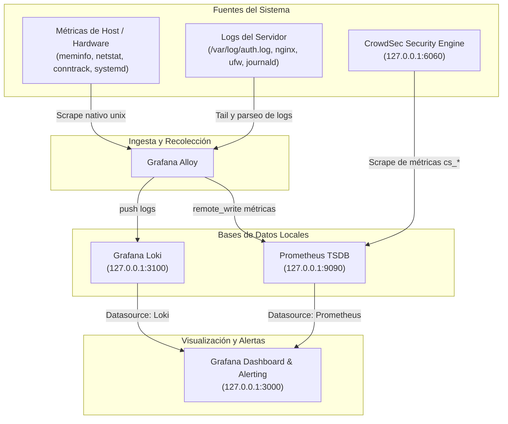

# Instalador seguro: Observabilidad y Seguridad Activa en Ubuntu

Paquete de aprovisionamiento seguro basado en el documento de arquitectura `Observabilidad y Seguridad Activa con Grafana en Ubuntu`.

## Alcance

- **Grafana OSS, Prometheus, Loki y Grafana Alloy**.
- **Colectores Unix**: meminfo, netstat, conntrack, softnet, systemd y procesos.
- **Flujo de métricas**: Alloy -> Prometheus por `127.0.0.1:9090`.
- **Flujo de logs**: Logs de autenticación, UFW, Nginx y journald hacia Loki en `127.0.0.1:3100`.
- **Datasources Grafana preconfigurados**: Prometheus y Loki conectados a loopback.
- **Reglas Prometheus**: CPU, RAM, disco, I/O, servicios systemd, SYN cookies, asimetría TCP, conntrack y métricas CrowdSec en `/etc/prometheus/rules/host-alerts.yml`.
- **Reglas LogQL**: Alertas en `rules/logql-alerts.md` para Grafana Alerting.
- **Reglas auditd**: Auditoría de identidad (`/etc/passwd`, `/etc/shadow`, sudoers) y SSH (`/etc/ssh/sshd_config`).
- **CrowdSec**: Motor de análisis local y colecciones `linux`, `sshd`, `nginx`, `base-http-scenarios`, `http-cve`.

---

## Arquitectura del Flujo de Datos



---

## Requisitos y Pre-flight

El instalador efectúa verificaciones previas automatizadas antes de alterar el sistema:
1. **Sistema Operativo**: Ubuntu Server 22.04 LTS (Jammy) o 24.04 LTS (Noble).
2. **Permisos**: Privilegios de superusuario (`root` o `sudo`).
3. **Init System**: systemd activo.
4. **Arquitectura**: amd64 (`x86_64`) o arm64 (`aarch64`).
5. **Memoria RAM**: Mínimo 2 GB (~1800 MB detectados libres/totales recomendados). Si se detecta menor capacidad, el script advierte y se detiene (se puede forzar con `--skip-preflight`).
6. **Espacio en disco**: Mínimo 3 GB de espacio libre en `/var` para TSDB de Prometheus y chunks de Loki.
7. **Conectividad a Internet**: Verificación HTTP/curl contra `archive.ubuntu.com` y `apt.grafana.com`.

---

## Uso y Opciones CLI

El instalador soporta argumentos por línea de comandos y mantiene compatibilidad con las variables de entorno previas.

### Sintaxis
```bash
sudo ./install.sh [OPCIONES]
```

### Opciones disponibles

| Opción | Descripción |
| :--- | :--- |
| `--port <PUERTO>` | Define el puerto HTTP de escucha para Grafana (por defecto: `3000`). Útil si el 3000 ya está ocupado. |
| `--dry-run` | Modo simulación: imprime cada comando y archivo a generar sin realizar cambios en el sistema. |
| `--skip-preflight` | Omite las comprobaciones de RAM, disco libre y conectividad ante entornos restringidos o containers. |
| `--no-crowdsec` | Omite la descarga, instalación y configuración de CrowdSec (equivalente a `INSTALL_CROWDSEC=0`). |
| `--with-bouncer` | Instala y activa el bouncer nftables de CrowdSec para bloqueo activo (equivalente a `INSTALL_BOUNCER=1`). |
| `--rollback <DIR>` | Restaura archivos de configuración y reglas de kernel desde un directorio de backup previo. |
| `--uninstall` | Detiene y deshabilita los servicios de la suite y retira las configuraciones creadas en `/etc`. |
| `-h`, `--help` | Muestra la ayuda de opciones y sintaxis. |

---

## Ejemplos de Ejecución

### 1. Instalación estándar (Detección segura)
Instala la suite completa con CrowdSec en modo auditoría/detección (sin alterar tablas nftables):
```bash
chmod +x install.sh
sudo ./install.sh
```

### 2. Instalación en un puerto alternativo (si el 3000 está ocupado)
```bash
sudo ./install.sh --port 3001
# O mediante variable de entorno:
sudo GRAFANA_PORT=3001 ./install.sh
```

### 3. Simulación (Dry-Run)
Verifica qué acciones se realizarían sin modificar el host:
```bash
sudo ./install.sh --dry-run
```

### 3. Instalación con bloqueo activo (Bouncer nftables)
```bash
sudo ./install.sh --with-bouncer
# O mediante variable de entorno:
sudo INSTALL_BOUNCER=1 ./install.sh
```

### 4. Instalación sin CrowdSec
```bash
sudo ./install.sh --no-crowdsec
# O mediante variable de entorno:
sudo INSTALL_CROWDSEC=0 ./install.sh
```

### 5. Restauración / Rollback
Cada ejecución crea automáticamente una copia de seguridad con fecha y hora en `/var/backups/observability-<timestamp>/`. Para revertir cambios a un estado previo:
```bash
sudo ./install.sh --rollback /var/backups/observability-20261101-153000
```
Esta acción restaura los archivos originales, reaplica `sysctl --system` y reinicia los servicios afectados.

### 6. Desinstalación
Detiene los servicios, desactiva sus unidades systemd y remueve las configuraciones y listas APT del paquete:
```bash
sudo ./install.sh --uninstall
```

---

## Acceso Seguro a los Paneles y Credenciales

Todos los servicios están configurados estrictamente en loopback (`127.0.0.1`). Para acceder a ellos de forma segura sin exponer puertos a Internet, utiliza un túnel SSH desde tu estación de trabajo local:

### 1. Grafana (Puerto 3000 o el especificado con `--port`)
Conexión por túnel SSH:
```bash
# Si usas el puerto por defecto (3000):
ssh -L 3000:127.0.0.1:3000 usuario@IP_DEL_SERVIDOR

# Si especificaste un puerto alternativo (ej. 3001):
ssh -L 3001:127.0.0.1:3001 usuario@IP_DEL_SERVIDOR
```
Abre en tu navegador `http://localhost:3000` (o `http://localhost:3001`) con el usuario `admin`. 

> [!IMPORTANT]
> **Gestión de credenciales y aislamiento de servicios:**
> - **Grafana (Único acceso administrativo con credenciales)**: Al finalizar la instalación, el script genera una contraseña criptográfica aleatoria de 24 caracteres para el usuario `admin`, la aplica sobre `/var/lib/grafana/grafana.db` y la muestra exclusivamente en la terminal. Por principios de seguridad (Zero-Trace), **esta contraseña NO se almacena en disco ni en `/var/log/observability-install.log`**. Debes copiarla y guardarla en tu gestor de contraseñas. Si requieres cambiarla manualmente en el futuro:
>   ```bash
>   sudo runuser -u grafana -- grafana cli \
>     --homepath "/usr/share/grafana" \
>     --config "/etc/grafana/grafana.ini" \
>     --configOverrides="cfg:default.paths.data=/var/lib/grafana cfg:default.paths.logs=/var/log/grafana cfg:default.paths.plugins=/var/lib/grafana/plugins" \
>     admin reset-admin-password 'TU_NUEVA_CONTRASEÑA'
>   ```
> - **Prometheus (`:9090`), Loki (`:3100`) y Alloy (`:12345`)**: 
>   Estos componentes operan como motores backend internos sin mecanismos de contraseña de usuario local por diseño. Su seguridad no depende de contraseñas, sino del **aislamiento estricto a nivel de socket de red**: están configurados para escuchar única y exclusivamente en la interfaz de loopback (`127.0.0.1`). Ningún proceso o cliente fuera del propio servidor puede comunicarse con ellos a menos que se abra un túnel SSH administrativo autenticado con clave privada.
> - **CrowdSec LAPI (`:8080`)**: Utiliza claves de máquina autogeneradas internamente para la comunicación entre el daemon `crowdsec`, `cscli` y los bouncers.

### Acceso administrativo opcional a Prometheus por túnel
Si un administrador necesita depurar métricas directamente en Prometheus sin pasar por Grafana:
```bash
ssh -L 9090:127.0.0.1:9090 usuario@IP_DEL_SERVIDOR
```
Abre en tu navegador `http://localhost:9090`.

> [!CAUTION]
> Nunca abras directamente en el firewall público los puertos `3000`, `9090`, `3100`, `12345` ni `6060`.

---

## Firewall (UFW): Directrices de Seguridad

El instalador **NO** habilita UFW ni modifica reglas SSH automáticamente para evitar dejar inoperativo el acceso remoto ante configuraciones personalizadas.

Antes de activar UFW:
1. Identifica el puerto SSH efectivo en uso:
   ```bash
   sudo sshd -T | grep -i '^port '
   ```
2. Autoriza dicho puerto y tus servicios web:
   ```bash
   sudo ufw default deny incoming
   sudo ufw default allow outgoing
   sudo ufw allow <PUERTO_SSH>/tcp
   sudo ufw allow 80/tcp
   sudo ufw allow 443/tcp
   sudo ufw enable
   ```
3. Mantén tu sesión actual abierta y valida la conectividad en una **segunda terminal independiente** antes de cerrar la primera.

---

## Formato JSON en Nginx

El archivo [`nginx/observability-log-format.conf`](file:///media/yaqui/Data1/App-dev/security/ubuntu-observability-secure/nginx/observability-log-format.conf) define el formato estructurado para alimentar a Loki y CrowdSec.

Para activarlo:
1. Copia o enlaza el snippet en `/etc/nginx/conf.d/observability-log-format.conf` dentro del bloque `http {}`.
2. En cada `server {}` de tus sitios web activos, declara:
   ```nginx
   access_log /var/log/nginx/access.log observability_json;
   ```
3. Valida la sintaxis y recarga el servidor web:
   ```bash
   sudo nginx -t
   sudo systemctl reload nginx
   ```

---

## Configuración de Alertas y Notificaciones (Contact Points)

Las reglas de Prometheus y Loki detectan anomalías y disparan alertas, pero **el servidor no incluye un servicio SMTP local**. Para recibir notificaciones, se configuran canales de entrega en Grafana Alerting:

### Opción A: Webhooks directos (Sin SMTP - Recomendado)

Puedes enviar alertas a Discord, Slack o Telegram vía HTTPS sin configurar servidores de correo:

1. Entra a Grafana (`http://localhost:3000` vía túnel SSH).
2. Ve al menú lateral: **Alerts & Incidents** (o icono de campana) > **Contact points**.
3. Haz clic en **Add contact point**:
   - **Discord**: Selecciona *Discord*, pega el *Webhook URL* de tu canal y haz clic en *Test*.
   - **Slack**: Selecciona *Slack*, pega el *Webhook URL* de la app de Slack y define el canal de destino (`#alertas`).
   - **Telegram**: Selecciona *Telegram*, introduce el `BOT API Token` (de `@BotFather`) y el `Chat ID`.
4. Guarda con **Save contact point**.
5. Ve a **Notification policies**, edita la política raíz (Root policy) y selecciona tu nuevo contact point como destino predeterminado.

### Opción B: Notificaciones por Correo (SMTP Externo)

Si prefieres recibir correos electrónicos, configura las credenciales de tu proveedor SMTP (Gmail, Sendgrid, Amazon SES o SMTP corporativo) en el archivo de Grafana:

Edita `/etc/grafana/grafana.ini` en la sección `[smtp]`:
```ini
[smtp]
enabled = true
host = smtp.tudominio.com:587
user = alertas@tudominio.com
password = """TU_PASSWORD_O_APP_KEY"""
from_address = alertas@tudominio.com
from_name = Grafana Observability
skip_verify = false
```

Reinicia Grafana para aplicar los cambios:
```bash
sudo systemctl restart grafana-server
```
Luego añade tu dirección de correo en Grafana: **Contact points** > **Add contact point** > Tipo: **Email**.

---

## Verificación Post-Instalación

```bash
# Estado de servicios
sudo systemctl --no-pager --full status grafana-server prometheus loki alloy crowdsec

# Verificación de sockets en loopback
sudo ss -lntp | grep -E ':(3000|9090|3100|12345|6060)\b'

# Validación de reglas Prometheus
sudo promtool check config /etc/prometheus/prometheus.yml
sudo promtool check rules /etc/prometheus/rules/host-alerts.yml

# Métricas y decisiones en CrowdSec
sudo cscli metrics
sudo cscli decisions list
```

---

## Fuentes Oficiales de Referencia

- [Grafana Installation on Debian/Ubuntu](https://grafana.com/docs/grafana/latest/setup-grafana/installation/debian/)
- [Grafana Alloy Linux Setup](https://grafana.com/docs/grafana-cloud/send-data/alloy/set-up/install/linux/)
- [Grafana Loki Installation](https://grafana.com/docs/loki/latest/setup/install/)
- [CrowdSec Linux Package Installation](https://docs.crowdsec.net/u/getting_started/installation/linux/)
- [CrowdSec Firewall Bouncer](https://docs.crowdsec.net/docs/bouncers/firewall/)
