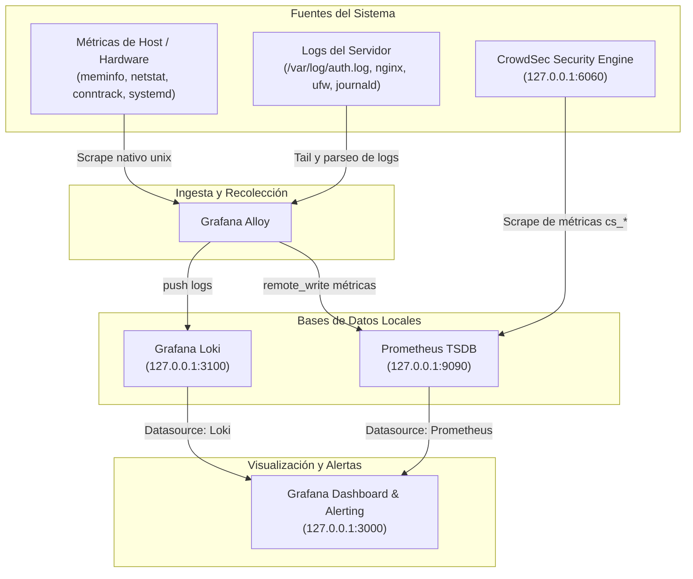
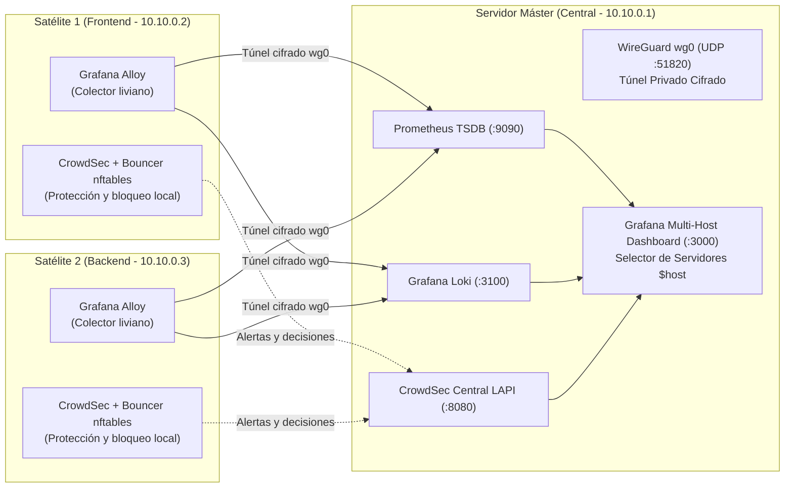

# Instalador seguro: Observabilidad y Seguridad Activa en Ubuntu

Paquete de aprovisionamiento seguro basado en el documento de arquitectura `Observabilidad y Seguridad Activa con Grafana en Ubuntu`.

## Alcance

- **Grafana OSS, Prometheus, Loki y Grafana Alloy**.
- **Colectores Unix**: meminfo, netstat, conntrack, softnet, systemd y procesos.
- **Flujo de métricas**: Alloy -> Prometheus por `127.0.0.1:9090`.
- **Flujo de logs**: Logs de autenticación (`/var/log/auth.log`), UFW (`/var/log/ufw.log`), todos los virtual hosts de Nginx (`/var/log/nginx/*access*.log` y `*error*.log`), **contenedores Docker** (`stdout` acceso y `stderr` errores vía `/var/run/docker.sock`) y `systemd-journal` hacia Loki en `127.0.0.1:3100`.
- **Datasources y Dashboard Grafana preconfigurados**: Prometheus y Loki conectados a loopback, más el panel **"Ubuntu Observabilidad & Seguridad Activa"** aprovisionado automáticamente como pantalla de inicio (*Home Dashboard*).
- **Catálogo de 16 Reglas de Alerta preaprovisionadas**: Las 5 reglas de salud/recursos del host (PromQL) y las 11 reglas de seguridad, DDoS L4/L7 y escaneo de bots (LogQL + PromQL) se inyectan automáticamente en **Grafana Unified Alerting** (`/etc/grafana/provisioning/alerting/observability-alerts.yml`) y en **Prometheus** (`/etc/prometheus/rules/host-alerts.yml`).
- **Reglas auditd**: Auditoría de identidad (`/etc/passwd`, `/etc/shadow`, sudoers) y SSH (`/etc/ssh/sshd_config`).
- **CrowdSec**: Motor de análisis local y colecciones `linux`, `sshd`, `nginx`, `base-http-scenarios`, `http-cve`.

---

## Arquitectura del Flujo de Datos



### Arquitectura Distribuida Multi-Host (Master y Satélites con WireGuard)

Cuando tus servicios están separados físicamente (por ejemplo: Frontend y Backend en distintos servidores o proveedores cloud):



* **Seguridad Activa Local en Satélites:** Cada satélite cuenta con su propio CrowdSec y bouncer `nftables`, bloqueando ataques en su propio firewall sin latencia de red.
* **Cero Servicios Pesados en Satélites:** En los satélites **no** se instala Grafana, Prometheus ni Loki; solo corre Alloy y CrowdSec (consumiendo apenas ~80MB RAM).
* **Defensa Coordinada:** Los satélites reportan incidentes al Máster, y el Máster sincroniza decisiones de bloqueo para que una IP maliciosa detectada en el Frontend sea neutralizada antes de alcanzar el Backend.

---

## Requisitos y Pre-flight

El instalador efectúa verificaciones previas automatizadas antes de alterar el sistema:
1. **Sistema Operativo**: Ubuntu Server 20.04, 22.04 LTS (Jammy) o 24.04 LTS (Noble).
2. **Permisos**: Privilegios de superusuario (`root` o `sudo`).
3. **Init System**: systemd activo.
4. **Arquitectura**: amd64 (`x86_64`) o arm64 (`aarch64`).
5. **Memoria RAM**:
   - Modo **Master** o **Standalone**: Mínimo 2 GB (~1800 MB recomendados) para la suite completa con TSDB locales (Grafana, Prometheus, Loki).
   - Modo **Satellite**: Mínimo 512 MB (~450 MB recomendados) ya que solo ejecuta Alloy y CrowdSec (consumo ~80MB).
6. **Espacio en disco**:
   - Modo **Master** o **Standalone**: Mínimo 3 GB libres en `/var` para TSDB de Prometheus y chunks de Loki.
   - Modo **Satellite**: Mínimo 500 MB libres (sin almacenamiento de base de datos local).
7. **Conectividad a Internet**: Verificación HTTP/curl contra `archive.ubuntu.com` y `apt.grafana.com`.

---

## Uso y Opciones CLI

El instalador soporta argumentos por línea de comandos y mantiene compatibilidad con las variables de entorno previas.

### Sintaxis
```bash
sudo ./install.sh [OPCIONES]
```

### Opciones disponibles

| Opción | Descripción |
| :--- | :--- |
| `--role <ROL>` | Rol del nodo: `standalone` (por defecto), `master` (control plane central) o `satellite` (nodo edge protegido). |
| `--satellites <LISTA>` | En modo Master: lista separada por comas de satélites a provisionar inicialmente (ej. `frontend,backend`). |
| `--add-satellite <NOMBRE>` | En modo Master: registra un nuevo nodo satélite y emite su comando de instalación listo para pegar. |
| `--port <PUERTO>` | Define el puerto HTTP de escucha para Grafana (por defecto: `3000`). Útil si el 3000 ya está ocupado. |
| `--dry-run` | Modo simulación: imprime cada comando y archivo a generar sin realizar cambios en el sistema. |
| `--skip-preflight` | Omite las comprobaciones de RAM, disco libre y conectividad ante entornos restringidos o containers. |
| `--no-crowdsec` | Omite la descarga, instalación y configuración de CrowdSec (equivalente a `INSTALL_CROWDSEC=0`). |
| `--with-bouncer` | Instala y activa el bouncer nftables de CrowdSec para bloqueo activo (equivalente a `INSTALL_BOUNCER=1`). |
| `--rollback <DIR>` | Restaura archivos de configuración y reglas de kernel desde un directorio de backup previo. |
| `--uninstall` | Detiene y deshabilita los servicios de la suite y retira las configuraciones creadas en `/etc`. |
| `-h`, `--help` | Muestra la ayuda de opciones y sintaxis. |

---

## Despliegue Multi-Host (Master y Satélites)

### 1. Instalación o Conversión Idempotente a Servidor Máster
Si estás instalando un nuevo servidor o **si ya tienes una instalación individual previa (*standalone*)**, ejecuta:
```bash
chmod +x install.sh
sudo ./install.sh --role master
```
> [!NOTE]
> **Actualización sin pérdida de datos:** Si el servidor ya tenía Grafana, Prometheus o Loki corriendo, el script detecta la instalación existente, preserva todas tus bases de datos, métricas y usuarios intactos, y únicamente configura el túnel **WireGuard** (`10.10.0.1`), ajusta los puertos de ingesta protegidos y actualiza el Dashboard multi-host.

Opcionalmente, puedes pre-declarar tus satélites conocidos:
```bash
sudo ./install.sh --role master --satellites "frontend,backend"
```

### 2. Registrar un Nuevo Satélite en el Máster
En cualquier momento puedes registrar un satélite ejecutando en el Máster:
```bash
sudo ./add_satellite.sh frontend
# O también mediante install.sh:
sudo ./install.sh --add-satellite frontend
```
Este comando reserva la IP interna en WireGuard (ej. `10.10.0.2`), imprime las claves y genera el comando seguro para vincular el satélite sin exponer contraseñas en flags de consola.

### 3. Instalación de un Nodo Satélite (Frontend / Backend)
En el servidor remoto (Frontend o Backend), clona el repositorio y ejecuta el instalador indicando el Máster:
```bash
sudo ./install.sh --role satellite \
  --name "frontend" \
  --master "IP_PUBLICA_DEL_MASTER:51820" \
  --master-key "CLAVE_PUBLICA_DEL_MASTER"
```

> **Seguridad y Cero Fuga en Historial:**
> - **Clave Pública del Máster:** La clave pasada en `--master-key` es la clave pública Curve25519 del Máster (diseñada por definición para ser pública y visible, no un secreto privado). Si prefieres no pasarla por consola, puedes omitir `--master-key` y el instalador te la solicitará en pantalla de forma interactiva.
> - **Claves WireGuard:** El satélite genera su propio par de claves criptográficas de forma 100% automática e imprime su Clave Pública en pantalla. La clave privada nunca viaja por la línea de comandos ni por la red.
> - **Auto-deducción de IP:** El satélite deduce su IP en WireGuard (`10.10.0.2` o la configurada previamente) sin requerir `--satellite-ip`.
> - **Protección contra fugas en bash history y `ps aux`:** No se pasan contraseñas en flags CLI. El agente de CrowdSec se registra en el LAPI del Máster en estado pendiente, y se activa de forma segura ejecutando en el Máster:
>   ```bash
>   sudo cscli machines validate frontend
>   ```

El satélite:
1. Establece el túnel WireGuard seguro (`10.10.0.2/24`).
2. Levanta **Grafana Alloy** enviando logs y métricas directamente a `10.10.0.1:9090` y `10.10.0.1:3100`.
3. Levanta **CrowdSec y el bouncer nftables** local para cortar ataques de firewall en el satélite.
4. Omite Grafana, Prometheus y Loki locales para un consumo mínimo de recursos (aprox. 120MB RAM).

---

## Ejemplos de Ejecución Standalone (Servidor Único)

### 1. Instalación estándar (Detección segura)
Instala la suite completa con CrowdSec en modo auditoría/detección (sin alterar tablas nftables):
```bash
chmod +x install.sh
sudo ./install.sh
```

### 2. Instalación en un puerto alternativo (si el 3000 está ocupado)
```bash
sudo ./install.sh --port 3001
# O mediante variable de entorno:
sudo GRAFANA_PORT=3001 ./install.sh
```

### 3. Simulación (Dry-Run)
Verifica qué acciones se realizarían sin modificar el host:
```bash
sudo ./install.sh --dry-run
```

### 3. Instalación con bloqueo activo (Bouncer nftables)
```bash
sudo ./install.sh --with-bouncer
# O mediante variable de entorno:
sudo INSTALL_BOUNCER=1 ./install.sh
```

### 4. Instalación sin CrowdSec
```bash
sudo ./install.sh --no-crowdsec
# O mediante variable de entorno:
sudo INSTALL_CROWDSEC=0 ./install.sh
```

### 5. Restauración / Rollback
Cada ejecución crea automáticamente una copia de seguridad con fecha y hora en `/var/backups/observability-<timestamp>/`. Para revertir cambios a un estado previo:
```bash
sudo ./install.sh --rollback /var/backups/observability-20261101-153000
```
Esta acción restaura los archivos originales, reaplica `sysctl --system` y reinicia los servicios afectados.

### 6. Desinstalación
Detiene los servicios, desactiva sus unidades systemd y remueve las configuraciones y listas APT del paquete:
```bash
sudo ./install.sh --uninstall
```

### 7. Actualización rápida solo de Grafana (sin reinstalar todo)
Si ya ejecutaste `install.sh` previamente y solo deseas inyectar el nuevo **Dashboard preconfigurado**, reparar la pantalla de inicio (*Home Dashboard*) o restablecer la contraseña de `admin` en la base de datos real (`/var/lib/grafana/grafana.db`):
```bash
chmod +x setup_grafana.sh
sudo ./setup_grafana.sh

# O si además deseas generar o fijar una nueva contraseña para 'admin':
sudo ./setup_grafana.sh --reset-password
sudo ./setup_grafana.sh --password 'TuNuevaPasswordSegura'
```

### 8. Aprovisionamiento y Personalización de las 16 Alertas (`setup_alerts.sh`)
Aunque `install.sh` y `setup_grafana.sh` ya instalan automáticamente las 16 reglas en Grafana, puedes usar `setup_alerts.sh` en cualquier momento para actualizarlas, personalizar umbrales o conectar canales de notificación (Discord, Slack, Telegram) desde la terminal:
```bash
chmod +x setup_alerts.sh
# Instalar/actualizar las 16 reglas en Grafana y Prometheus:
sudo ./setup_alerts.sh

# Silenciar la alerta informativa de cada Login SSH Exitoso y subir el umbral HTTP flood a 800 req/s:
sudo ./setup_alerts.sh --ssh-login-alert off --http-rps-threshold 800

# Configurar automáticamente un Contact Point de Discord, Slack o Telegram:
sudo ./setup_alerts.sh --discord-webhook 'https://discord.com/api/webhooks/ID/TOKEN'
sudo ./setup_alerts.sh --slack-webhook 'https://hooks.slack.com/services/T00/B00/X00'
sudo ./setup_alerts.sh --telegram '123456:ABC-DEF...' '-100123456789'
```

### 9. Diagnóstico y Autorreparación (`doctor.sh`)
La herramienta de diagnóstico detecta automáticamente si el servidor actúa como **Master**, **Satellite** o **Standalone** y adapta sus comprobaciones en consecuencia:
```bash
chmod +x doctor.sh
sudo ./doctor.sh

# O en modo solo lectura (sin aplicar cambios):
sudo ./doctor.sh --check-only
```
`doctor.sh` verifica y corrige automáticamente:
- **Detección de Rol y Túnel WireGuard**: Si es un satélite, valida el estado de la interfaz `wg0`, prueba el enlace ICMP/ping contra el Máster (`10.10.0.1`) y confirma que los endpoints de Prometheus (`:9090`) y Loki (`:3100`) del Máster estén respondiendo correctamente.
- **Aislamiento de Servicios Omitidos**: En los satélites, omite comprobar Prometheus, Loki o Grafana locales, evitando falsos positivos.
- **Permisos de Logs y Grupos de Alloy**: Verifica grupos suplementarios (`adm`, `systemd-journal`, `docker`) para la lectura de `/var/log/auth.log`, Nginx y Docker sockets.
- **Salud de Base de Datos y Permisos**: Propiedad `loki:loki` en chunks y compactor, permisos de reglas y arranque ordenado de servicios.
- **Ingesta Real de Telemetría**: Comprueba que Alloy esté entregando métricas a Prometheus y flujos de logs `{job="ssh_auth"}` a Loki (reseteando automáticamente el caché de posiciones si quedaron bloqueados).

### 10. Gestión de Listas Blancas en CrowdSec (Países, Regiones e IPs)
Para evitar falsos positivos o bloqueos accidentales a usuarios, empleados o clientes legítimos, la suite incluye herramientas dedicadas con validación sintáctica y desbloqueo activo inmediato:

#### A. Autorizar un País o Región Completa (`scripts/whitelist_country.sh`)
Permite autorizar todo el tráfico procedente de uno o más países utilizando su código ISO 3166-1 alpha-2 de 2 letras (ej. `CO` Colombia, `ES` España, `MX` México, `AR` Argentina, `US` Estados Unidos, `CL` Chile, etc.):
```bash
# Autorizar todo el tráfico de un país con motivo descriptivo:
sudo ./scripts/whitelist_country.sh CO "Tráfico nacional legítimo de Colombia"
sudo ./scripts/whitelist_country.sh ES "Clientes corporativos de España"
sudo ./scripts/whitelist_country.sh MX "Operaciones en México"
```
**Mecanismo de acción:**
1. Agrega la excepción en los parsers de enriquecimiento GeoIP (`/etc/crowdsec/parsers/s02-enrich/99_custom_country_whitelists.yaml`) mediante `evt.Enriched.IsoCode`.
2. Agrega la excepción en postoverflows (`/etc/crowdsec/postoverflows/s01-whitelist/99_custom_country_whitelists.yaml`) mediante `evt.Overflow.Alert.Source.Cn`.
3. **Desbanque automático**: Si alguna IP de ese país fue bloqueada con anterioridad, el script la detecta y elimina la decisión de ban en tiempo real.
4. Valida la sintaxis con `crowdsec -t` y recarga el servicio sin caídas.

#### B. Autorizar una IP Fija o Rango CIDR (`scripts/whitelist_ip.sh`)
Permite excluir permanentemente de baneos una IP de oficina, VPN corporativa o segmento de red:
```bash
# Autorizar una IP individual:
sudo ./scripts/whitelist_ip.sh 198.51.100.25 "Oficina Central"

# Autorizar un rango CIDR completo:
sudo ./scripts/whitelist_ip.sh 10.10.0.0/24 "Red privada WireGuard de satélites"
```
**Mecanismo de acción:**
1. Desbloquea inmediatamente la IP o rango si existe un ban activo.
2. Inyecta la regla en `/etc/crowdsec/parsers/s02-enrich/99_custom_whitelists.yaml`.
3. Valida la sintaxis y recarga CrowdSec.

---

## Acceso Seguro a los Paneles y Credenciales

Todos los servicios están configurados estrictamente en loopback (`127.0.0.1`). Para acceder a ellos de forma segura sin exponer puertos a Internet, utiliza un túnel SSH desde tu estación de trabajo local:

### 1. Grafana (Puerto 3000 o el especificado con `--port`)
Conexión por túnel SSH:
```bash
# Si usas el puerto por defecto (3000):
ssh -L 3000:127.0.0.1:3000 usuario@IP_DEL_SERVIDOR

# Si especificaste un puerto alternativo (ej. 3001):
ssh -L 3001:127.0.0.1:3001 usuario@IP_DEL_SERVIDOR
```
Abre en tu navegador `http://localhost:3000` (o `http://localhost:3001`) con el usuario `admin`. 

Al iniciar sesión, **se abrirá automáticamente en la pantalla de inicio (Home)** el panel preconfigurado **"Ubuntu Observabilidad & Seguridad Activa"** (también accesible desde el menú lateral **Dashboards** > carpeta **Observabilidad y Seguridad**), el cual incluye:
1. **Vista Global de la Flota (Tabla Interactiva Multi-Host)**: Muestra en tiempo real todos los nodos conectados (Hostname, % CPU, % RAM, % Disco). **Al hacer clic sobre el nombre de un servidor en la tabla, el dashboard actualiza automáticamente la variable `$host`, mostrando exclusivamente las métricas y logs de esa máquina.**
2. **Selector Dinámico `$host`**: Menú desplegable superior que permite alternar entre ver la flota consolidada (`All`) o filtrar por un satélite o máster específico.
3. **Estado General y Recursos**: Gauges en tiempo real de CPU, Memoria RAM, Disco Raíz (`/`), saturación de tabla Conntrack, IPs bloqueadas activamente en CrowdSec e intentos fallidos de SSH en los últimos 15 minutos.
4. **Rendimiento del Host y Red**: Series temporales de CPU/RAM, tráfico de segmentos TCP In/Out + SYN Cookies enviadas, saturación I/O de disco y estado en vivo de servicios críticos (`ssh`, `nginx`, `crowdsec`, `prometheus`, `loki`, `alloy`, `grafana-server`).
5. **Seguridad Activa, SSH, Firewall y Web (Loki Logs)**: Histograma de volumen de eventos por fuente y visores de logs en vivo para autenticación SSH/sudo (`/var/log/auth.log`), firewall UFW + errores de Nginx, y accesos web + `systemd-journal`.

> [!IMPORTANT]
> **Gestión de credenciales y aislamiento de servicios:**
> - **Grafana (Único acceso administrativo con credenciales)**: Al finalizar la instalación, el script genera una contraseña criptográfica aleatoria de 24 caracteres para el usuario `admin`, la aplica sobre `/var/lib/grafana/grafana.db` y la muestra exclusivamente en la terminal. Por principios de seguridad (Zero-Trace), **esta contraseña NO se almacena en disco ni en `/var/log/observability-install.log`**. Debes copiarla y guardarla en tu gestor de contraseñas. Si requieres cambiarla manualmente en el futuro:
>   ```bash
>   sudo runuser -u grafana -- grafana cli \
>     --homepath "/usr/share/grafana" \
>     --config "/etc/grafana/grafana.ini" \
>     --configOverrides="cfg:default.paths.data=/var/lib/grafana cfg:default.paths.logs=/var/log/grafana cfg:default.paths.plugins=/var/lib/grafana/plugins" \
>     admin reset-admin-password 'TU_NUEVA_CONTRASEÑA'
>   ```
> - **Prometheus (`:9090`), Loki (`:3100`) y Alloy (`:12345`)**: 
>   Estos componentes operan como motores backend internos sin mecanismos de contraseña de usuario local por diseño. Su seguridad no depende de contraseñas, sino del **aislamiento estricto a nivel de socket de red**: están configurados para escuchar única y exclusivamente en la interfaz de loopback (`127.0.0.1`). Ningún proceso o cliente fuera del propio servidor puede comunicarse con ellos a menos que se abra un túnel SSH administrativo autenticado con clave privada.
> - **CrowdSec LAPI (`:8080`)**: Utiliza claves de máquina autogeneradas internamente para la comunicación entre el daemon `crowdsec`, `cscli` y los bouncers.

### Acceso administrativo opcional a Prometheus por túnel
Si un administrador necesita depurar métricas directamente en Prometheus sin pasar por Grafana:
```bash
ssh -L 9090:127.0.0.1:9090 usuario@IP_DEL_SERVIDOR
```
Abre en tu navegador `http://localhost:9090`.

> [!CAUTION]
> Nunca abras directamente en el firewall público los puertos `3000`, `9090`, `3100`, `12345` ni `6060`.

---

## Firewall (UFW): Directrices de Seguridad

El instalador **NO** habilita UFW ni modifica reglas SSH automáticamente para evitar dejar inoperativo el acceso remoto ante configuraciones personalizadas.

Antes de activar UFW:
1. Identifica el puerto SSH efectivo en uso:
   ```bash
   sudo sshd -T | grep -i '^port '
   ```
2. Autoriza dicho puerto y tus servicios web:
   ```bash
   sudo ufw default deny incoming
   sudo ufw default allow outgoing
   sudo ufw allow <PUERTO_SSH>/tcp
   sudo ufw allow 80/tcp
   sudo ufw allow 443/tcp
   sudo ufw enable
   ```
3. Mantén tu sesión actual abierta y valida la conectividad en una **segunda terminal independiente** antes de cerrar la primera.

---

## Formato JSON en Nginx

El archivo [`nginx/observability-log-format.conf`](file:///media/yaqui/Data1/App-dev/security/ubuntu-observability-secure/nginx/observability-log-format.conf) define el formato estructurado para alimentar a Loki y CrowdSec.

Para activarlo:
1. Copia o enlaza el snippet en `/etc/nginx/conf.d/observability-log-format.conf` dentro del bloque `http {}`.
2. En cada `server {}` de tus sitios web activos, declara:
   ```nginx
   access_log /var/log/nginx/access.log observability_json;
   ```
3. Valida la sintaxis y recarga el servidor web:
   ```bash
   sudo nginx -t
   sudo systemctl reload nginx
   ```

---

## Catálogo de 16 Reglas de Alerta Preaprovisionadas y Notificaciones

El sistema aprovisiona de fábrica las **16 reglas de alerta** definidas en la arquitectura dentro de **Grafana Unified Alerting** (menú **Alerting** > **Alert rules** > carpeta **Observabilidad y Seguridad**):

### Grupo 1: `salud-y-recursos-host` (5 Reglas PromQL)
| # | UID | Regla en Grafana | Condición / Umbral | Duración (`for`) | Severidad |
| :- | :--- | :--- | :--- | :--- | :--- |
| 1 | `alert_host_cpu_high` | `[Recursos] Saturación de CPU (>85%)` | Uso de CPU `> 85%` | `5m` | `warning` |
| 2 | `alert_host_ram_critical` | `[Recursos] Memoria RAM Crítica (>90%)` | Memoria usada `> 90%` | `5m` | `critical` |
| 3 | `alert_host_disk_full` | `[Recursos] Almacenamiento Lleno (>85%)` | Disco ocupado `> 85%` (excl. tmpfs/overlay) | `10m` | `warning` |
| 4 | `alert_host_disk_io` | `[Recursos] Cuello de Botella I/O (>80%)` | Tiempo de I/O de disco `> 80%` | `5m` | `warning` |
| 5 | `alert_systemd_service_down` | `[Disponibilidad] Servicio Crítico Caído` | `ssh`, `sshd`, `nginx` o `crowdsec` inactivo (`< 1`) | `1m` | `critical` |

### Grupo 2: `seguridad-ddos-y-accesos` (11 Reglas LogQL y PromQL)
| # | UID | Regla en Grafana | Fuente | Condición / Umbral | Duración (`for`) | Severidad |
| :- | :--- | :--- | :--- | :--- | :--- | :--- |
| 6 | `alert_ssh_brute_force` | `[Acceso] Fuerza Bruta SSH (>15 en 5m)` | Loki (`ssh_auth`) | `> 15` `"Failed password"` en 5m | `0s` | `warning` |
| 7 | `alert_ssh_login_success` | `[Acceso] Login SSH Exitoso` | Loki (`ssh_auth`) | `> 0` `"Accepted "` en 5m | `0s` | `info` |
| 8 | `alert_sudo_auth_failure` | `[Acceso] Fallo de Sudo / Escalada (>2 en 5m)` | Loki (`ssh_auth`) | `> 2` fallos PAM de `sudo:` en 5m | `0s` | `critical` |
| 9 | `alert_ddos_syn_flood` | `[DDoS L4] Inundación SYN Flood (SYN Cookies)` | Prometheus | `rate(SyncookiesSent[1m]) > 0` | `1m` | `warning` |
| 10 | `alert_ddos_tcp_asymmetry` | `[DDoS L4] Asimetría de Segmentos TCP (Ratio > 5)` | Prometheus | Ratio `Tcp_InSegs / Tcp_OutSegs > 5` | `2m` | `warning` |
| 11 | `alert_ddos_conntrack_limit` | `[DDoS L4] Tabla Conntrack al Límite (>80%)` | Prometheus | Uso de tabla `nf_conntrack > 80%` | `2m` | `critical` |
| 12 | `alert_ddos_http_flood` | `[DDoS L7] Inundación HTTP Web (>400 req/s)` | Loki (`nginx_access`) | Tasa global `> 400 req/s` | `2m` | `critical` |
| 13 | `alert_bot_403_404_burst` | `[Bot Scan] Ráfaga de Errores 404/403 (>100/min)` | Loki (`nginx_access`) | `> 100` errores `403\|404` por minuto | `2m` | `warning` |
| 14 | `alert_bot_critical_paths` | `[Bot Scan] Sondeo de Rutas Críticas (.env/.git/wp-admin)` | Loki (`nginx_access`) | `> 10` accesos a `.env/.git/wp-admin/...` en 5m | `0s` | `warning` |
| 15 | `alert_bot_vuln_scanner` | `[Bot Scan] Escáner de Vulnerabilidades (sqlmap/nikto/nuclei)` | Loki (`nginx_access`) | `> 0` firmas de `sqlmap/nikto/nuclei/nmap/...` | `0s` | `critical` |
| 16 | `alert_crowdsec_ban_wave` | `[IPS] Oleada de Bloqueos CrowdSec (>50 decisiones)` | Prometheus | `cs_active_decisions > 50` | `1m` | `warning` |

### Configuración de Canales de Entrega (Contact Points)

Las 16 reglas evalúan métricas y logs continuamente, pero **el servidor no incluye un servicio SMTP local**. Puedes configurar el canal de entrega automáticamente con `setup_alerts.sh` o desde la interfaz web:

#### Vía CLI Automatizada (Recomendado)
```bash
sudo ./setup_alerts.sh --discord-webhook 'https://discord.com/api/webhooks/...'
# O para Slack / Telegram:
sudo ./setup_alerts.sh --slack-webhook 'https://hooks.slack.com/services/...'
sudo ./setup_alerts.sh --telegram 'BOT_TOKEN' 'CHAT_ID'
```

#### Opción A: Webhooks directos en la UI de Grafana (Sin SMTP)

Puedes enviar alertas a Discord, Slack o Telegram vía HTTPS sin configurar servidores de correo:

1. Entra a Grafana (`http://localhost:3000` vía túnel SSH).
2. Ve al menú lateral: **Alerts & Incidents** (o icono de campana) > **Contact points**.
3. Haz clic en **Add contact point**:
   - **Discord**: Selecciona *Discord*, pega el *Webhook URL* de tu canal y haz clic en *Test*.
   - **Slack**: Selecciona *Slack*, pega el *Webhook URL* de la app de Slack y define el canal de destino (`#alertas`).
   - **Telegram**: Selecciona *Telegram*, introduce el `BOT API Token` (de `@BotFather`) y el `Chat ID`.
4. Guarda con **Save contact point**.
5. Ve a **Notification policies**, edita la política raíz (Root policy) y selecciona tu nuevo contact point como destino predeterminado.

### Opción B: Notificaciones por Correo (SMTP Externo)

Si prefieres recibir correos electrónicos, configura las credenciales de tu proveedor SMTP (Gmail, Sendgrid, Amazon SES o SMTP corporativo) en el archivo de Grafana:

Edita `/etc/grafana/grafana.ini` en la sección `[smtp]`:
```ini
[smtp]
enabled = true
host = smtp.tudominio.com:587
user = alertas@tudominio.com
password = """TU_PASSWORD_O_APP_KEY"""
from_address = alertas@tudominio.com
from_name = Grafana Observability
skip_verify = false
```

Reinicia Grafana para aplicar los cambios:
```bash
sudo systemctl restart grafana-server
```
Luego añade tu dirección de correo en Grafana: **Contact points** > **Add contact point** > Tipo: **Email**.

---

## Verificación Post-Instalación

```bash
# Estado de servicios
sudo systemctl --no-pager --full status grafana-server prometheus loki alloy crowdsec

# Verificación de sockets en loopback
sudo ss -lntp | grep -E ':(3000|9090|3100|12345|6060)\b'

# Validación de reglas Prometheus
sudo promtool check config /etc/prometheus/prometheus.yml
sudo promtool check rules /etc/prometheus/rules/host-alerts.yml

# Métricas y decisiones en CrowdSec
sudo cscli metrics
sudo cscli decisions list
```

---

## Solución de Problemas Frecuentes

### 1. Dependencias rotas en APT (`apt --fix-broken install`)
Si el servidor de destino tiene paquetes rotos o dependencias pendientes de instalaciones previas ajenas a la suite (por ejemplo repositorios externos de MongoDB, auditd o paquetes interrumpidos):
```bash
# 1. Configurar paquetes a medio desempaquetar:
sudo dpkg --configure -a

# 2. Reparar dependencias rotas automáticamente:
sudo apt-get update
sudo apt --fix-broken install -y
```
Una vez limpio el gestor APT de tu servidor, vuelve a lanzar el instalador (`sudo ./install.sh ...`). El script ahora incluye saneamiento automático previo de dpkg/apt y gestión adaptativa de paquetes de auditoría según la versión de Ubuntu.

---

## Fuentes Oficiales de Referencia

- [Grafana Installation on Debian/Ubuntu](https://grafana.com/docs/grafana/latest/setup-grafana/installation/debian/)
- [Grafana Alloy Linux Setup](https://grafana.com/docs/grafana-cloud/send-data/alloy/set-up/install/linux/)
- [Grafana Loki Installation](https://grafana.com/docs/loki/latest/setup/install/)
- [CrowdSec Linux Package Installation](https://docs.crowdsec.net/u/getting_started/installation/linux/)
- [CrowdSec Firewall Bouncer](https://docs.crowdsec.net/docs/bouncers/firewall/)
